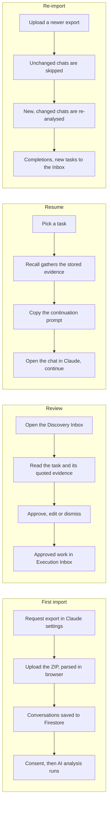
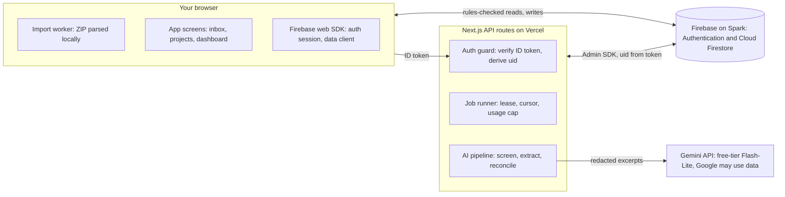

# Recall — Architecture

Approved on 14 November 2026. This is the Milestone 1 proposal as approved; later changes are recorded in `DEVELOPMENT_NOTES.md`.

## Decisions recorded at approval

| # | Decision | Outcome |
| --- | --- | --- |
| 1 | Send conversations to the free Gemini API | Yes, with redaction, a consent screen and per-conversation exclusion; local Ollama provider follows the MVP |
| 2 | Message storage | Conversation metadata plus message text packed into chunk documents |
| 3 | Models | `gemini-3.5-flash-lite` for the pipeline; Flash reserved for resume prompts and the weekly report |
| 4 | Multi-day analysis | Accepted; jobs pause at quota and resume |
| 5 | Real export sample | Export received; structure report to be produced with `scripts/inspect-claude-export.mjs` before Milestone 4 |

The proposal's schema changes (embedded evidence, no reminders collection, five task statuses) were approved with it.

## Amendments since approval

| Date | Change | Reason |
| --- | --- | --- |
| 14 Nov 2026 | The Claude export is a manifest plus one ZIP per category (`conversations-000.zip`, `projects-000.zip`, `memories-000.zip`, `design_chats-000.zip`, `frames-000.zip`, `claude_code_cloud-000.zip`, `light_metadata-000.zip`), each possibly split into numbered parts. Section 7 assumed a single archive. The importer will accept one or more `conversations-NNN.zip` files in a single import. | Observed in a real export manifest (version 1.0) |
| 14 Nov 2026 | Conversations carry a client-written `needsAnalysis` boolean. The server-owned `analysis` map no longer drives the analysis queue query. | Lets the import mark work for analysis without the client writing a server-owned field |
| 14 Nov 2026 | Firestore writes require a verified email, and the profile document is created on first entry to the app after verification. | Keeps unverified accounts from writing anything |

## Summary and decisions needed

Recall is buildable on the approved zero-cost stack, but three of the prompt's assumptions do not survive contact with the current free tiers. I need your call on five points before Milestone 2 starts. No application code has been written.

**What I verified today**

- The repo is an untouched `create-next-app` scaffold on Next.js 16.4.6 with one commit. Nothing from Milestones 2 to 10 exists yet.
- The Gemini free tier is far smaller than most guides still claim. Flash models allow about 20 requests a day; Flash-Lite models allow about 500 a day.
- Google's terms for the unpaid Gemini API say content is used to improve Google products, may be read by human reviewers, and should not include personal or confidential information.
- Firestore Spark allows 20,000 writes a day and 1 GiB of storage. A message-per-document model would exhaust the write quota on a single large import.
- Vercel Hobby functions now run for up to 300 seconds, which is enough for chunked, user-triggered jobs. Hobby is limited to personal, non-commercial use.

**Decisions I need from you**

| # | Decision | My recommendation | Why it matters |
| --- | --- | --- | --- |
| 1 | Send personal conversations to the free Gemini API, despite Google's terms? | Yes for the MVP, with redaction, an explicit consent screen, per-conversation exclusion, and the Ollama provider as the first post-MVP item | This is the largest privacy trade-off in the product. It is your data, so it is your call. |
| 2 | Store full message text in Firestore, or only what the pipeline needs? | Store conversation metadata plus message text packed into chunk documents of about 200 KB each | Keeps a 1,000-conversation import near 2,200 writes instead of 30,000 or more |
| 3 | Which Gemini model? | `gemini-3.5-flash-lite` for screening and extraction; reserve the 20 daily Flash requests for resume prompts and the weekly report | Flash alone cannot process an archive at 20 requests a day |
| 4 | Accept that analysing a first full import can spill into a second day or more? | Yes. Jobs pause at quota and resume the next day without losing work | 500 requests a day is a hard ceiling with no free workaround |
| 5 | Provide a real export sample before Milestone 4? | Yes. Request your export now; I build the parser against synthetic fixtures first, then validate against your real file's structure | Anthropic does not document the export format, and the prompt forbids assuming it |

**Three places I am pushing back on the brief**

- **Separate `evidence` collection.** I propose embedding evidence inside each task document. Evidence is always read with its task, so a separate collection doubles reads and writes for no query benefit.
- **Reminders and activity logs in the MVP.** Scheduled reminders need background infrastructure the free stack does not have. I propose in-app due markers only, and a capped activity log.
- **Seven task statuses.** `discovered`, `awaiting_review` and `uncertain` overlap. I propose status = `awaiting_review | approved | in_progress | completed | dismissed`, with uncertainty carried by the confidence score.

## 1. Environment inspection

The repository at `IsraelChidera/Recall` holds only the default Next.js scaffold, so every milestone after this one starts from zero.

| Item | Found | Consequence |
| --- | --- | --- |
| Commits | 1 (`Initial commit from Create Next App`) on `master` | No prior architecture to reconcile |
| Framework | Next.js 16.4.6, React 19.3.0, App Router, Turbopack | `AGENTS.md` warns this Next version has breaking changes; I will read `node_modules/next/dist/docs/` before writing any code |
| Styling | Tailwind CSS 4.3.3 through `@tailwindcss/turbopack` | CSS-first config; shadcn/ui must be initialised for Tailwind 4 |
| TypeScript | `strict: true`, `@/*` path alias at repo root | Keep; add `noUncheckedIndexedAccess` for parser safety |
| Next config | `cacheComponents`, `partialPrefetching`, `experimental.agentFeedback` enabled | Authenticated pages must opt out of caching explicitly; I will confirm behaviour in the bundled docs |
| Not present | Firebase, shadcn/ui, Lucide, JSZip, Zod, Gemini SDK, Vitest, `.env.example`, CI, tests, `firestore.rules` | All of Milestone 2 and 3 remain |
| Tooling here | Node 22, npm 10, git, Java (needed by the Firebase emulators) | Emulator-based rule tests can run in my workspace |

Current package versions I will pin against: `firebase` 13.3.0, `firebase-admin` 14.5.1, `firebase-tools` 15.36.0, `jszip` 3.10.2, `zod` 4.6.7, `@google/genai` 3.3.0, `vitest` 5.1.0, `@firebase/rules-unit-testing` 6.0.0.

One thing I cannot see from here: your Firebase project. I do not know whether Authentication providers are enabled, which Firestore region and mode were chosen, or whether the database is currently in open test mode. If it is in test mode, it is readable by anyone until the rules in section 6 are deployed.

## 2. Product requirements

Recall turns a Claude data export into a reviewed list of unfinished work, each item backed by a quote from the conversation it came from, with a one-click prompt to pick the work back up.

**Primary user.** One person (you) who uses Claude daily across engineering, business, study and content work, and who will not maintain a manual task list.

**Core loop.** Import, discover, understand, prioritise, resume, execute. Recall does the first three; you decide the last three.

**In scope for the MVP**

| Area | Requirement | Acceptance test |
| --- | --- | --- |
| Accounts | Email and password registration, login, logout, password reset | A second account cannot read the first account's data (emulator test) |
| Import | Upload the Claude export ZIP; parse in the browser; show progress and errors | A synthetic 1,000-conversation archive imports without the tab exceeding its memory budget |
| Idempotency | Re-uploading the same archive writes nothing; a newer archive writes only changes | Second import of an identical file reports 0 new, 0 updated |
| Discovery | Screen, extract, reconcile and score conversations with Gemini | Every stored task carries at least one quote found verbatim in its source message |
| Review | Discovery Inbox: approve, dismiss, edit, re-prioritise, assign to project | Dismissed items never reappear after re-import |
| Execution | Execution Inbox and Dashboard for approved work | Approved tasks sort by priority, project and status |
| Projects | Projects grouped from related conversations, with decisions and open deliverables | A project lists its source conversations with links |
| Forgotten Work | Inactive items ranked by commitment strength, not age alone | A brainstorm-only conversation never appears here |
| Resume | Continuation prompt built from stored evidence; copy button; link to the original chat | Prompt contains only decisions present in stored evidence |
| Weekly Intelligence | On-demand weekly summary, cached per week | Regenerating in the same week makes no new AI request |
| Data control | Exclude a conversation from AI; delete a source's data; delete the account | After deletion, a Firestore query for that user returns no documents |
| Quotas | Usage meter; jobs pause at quota and resume | A job stopped mid-run resumes without duplicate tasks |

**Out of scope for the MVP**

- ChatGPT and other importers. The source adapter interface exists; only the Claude adapter is built.
- Automatic sync with claude.ai. No authorised integration exists, and Recall will never ask for Claude credentials or cookies.
- Email or push reminders, calendar and email integration, knowledge graph, cross-platform search.
- Manual task creation. Recall discovers work; it is not a to-do list.
- Multi-user launch. The free Gemini quota is shared per project, so the MVP is single-user by design (see section 11).

**Product rules the AI must obey**

- No task without evidence. No deadline unless the user stated one. No completion without a quote showing it.
- Brainstorming and interest are recorded as context, not turned into tasks.
- The model never supplies identifiers. The server assigns every ID and reference.
- A user decision (approve, dismiss, edit) always outranks a later AI re-evaluation.

## 3. User journeys

Recall has four journeys. Each one ends with something you can act on, and none of them asks you to type a task.



Read each lane left to right; the highlighted box is the outcome.

**Where each journey can stop, and what you see**

| Journey | Failure point | What Recall shows |
| --- | --- | --- |
| First import | Not a Claude export, or a corrupt ZIP | A specific validation message before anything is written |
| First import | Tab closed mid-import | "Import paused at 340 of 1,000"; selecting the same file resumes |
| First import | Consent declined | Conversations stay imported; analysis stays off until you opt in |
| First import | Gemini quota reached | "Analysis paused, resumes after the daily reset", with progress kept |
| Review | Low-confidence discovery | A "needs a closer look" flag and the quote, so you can judge quickly |
| Resume | Daily Flash allowance spent | A template-built prompt from stored evidence, labelled as such |
| Re-import | Same file uploaded twice | "Nothing new in this export" and zero writes |
| Re-import | A task you dismissed is found again | It stays dismissed; your decision outranks the model |

**First-run order.** Registration leads to email verification, then straight to the Import Centre, which explains how to request the export from Claude. The dashboard stays empty until the first import, and says what to do next.

## 4. System architecture

The browser does the heavy lifting and the server does the trusted work. The ZIP is parsed and written to Firestore from the browser; the server exists only to verify identity, hold the Gemini key and write AI results.



The highlighted box is the only place conversation text leaves infrastructure you control.

**Who does what, and why**

| Component | Responsibility | Why here |
| --- | --- | --- |
| Import worker (browser) | Validate ZIP, stream-parse, normalise, hash, batch-write | The ZIP never has to leave your machine, and Vercel request bodies are far too small for an archive |
| Firebase web SDK (browser) | Sign-in, token refresh, reads and user-decision writes under security rules | Rules give per-user isolation without a server round trip |
| Auth guard (server) | Verify the ID token and derive `uid` on every request | The Admin SDK bypasses rules, so the server must authorise by itself |
| Job runner (server) | Lease the job, process one slice, save the cursor, enforce the usage cap | Functions are short-lived; state must live in Firestore |
| AI pipeline (server) | Redact, prompt, call Gemini, validate with Zod, verify quotes, persist | The Gemini key and the write authority for discoveries stay off the client |
| Firestore | System of record for conversations, discoveries, jobs and usage | The only stateful service in the stack |

**Request flow for analysis**

1. The browser creates a job with `POST /api/jobs`. The server checks consent and the daily cap, then writes a `jobs` document.
2. The browser calls `POST /api/jobs/{id}/advance` repeatedly. Each call takes a 90-second lease, runs up to four Gemini requests, writes results and the new cursor, and returns progress.
3. The browser listens to the job document for live progress. Closing the tab stops the loop; the job stays at its cursor.
4. On quota or repeated failure, the job moves to `paused_quota` or `failed` with a readable reason and a retry count.

**Trade-offs I am choosing**

- **Client-side writes for imports.** Faster and free of function limits, but validation of imported data is done by security rules, not server code. Rules cap sizes and shapes; the content is your own data in your own space.
- **Tab-driven jobs over a scheduler.** Zero cost and simple, but analysis only advances while Recall is open.
- **One region, one database.** No caching layer and no search index. Lists are small and paginated, so Firestore queries are enough for the MVP.
- **No server-rendered private data.** Simpler security model; authenticated pages render on the client after sign-in.

## 5. Proposed Firestore schema

The schema is shaped by one constraint: 20,000 writes a day. Message text is packed into chunk documents, and evidence lives inside the task it supports. Everything sits under `users/{uid}` so one ownership rule covers all of it.

| Path | Holds | Written by | Typical size | Volume for 1,000 conversations |
| --- | --- | --- | --- | --- |
| `users/{uid}` | Profile, AI consent flag and date, preferences | Client (limited fields) | Under 1 KB | 1 |
| `users/{uid}/sources/{sourceId}` | One per platform (`claude`); adapter version, last import, counts | Client | Under 1 KB | 1 |
| `users/{uid}/sourceIndex/{shardId}` | Map of conversation ID to content hash, up to 2,000 entries per document | Client | Up to 250 KB | 1 |
| `users/{uid}/imports/{importId}` | File fingerprint, status, checkpoint cursor, counts, errors (capped at 50) | Client | 2 to 20 KB | 1 per upload |
| `users/{uid}/conversations/{convId}` | Title, timestamps, message count, content hash, source URL, `excluded`, `analysis` state | Client; `analysis` by server | 1 to 2 KB | 1,000 |
| `users/{uid}/conversations/{convId}/chunks/{n}` | Ordered messages (ID, sender, timestamp, text) packed to about 200 KB | Client | Up to 200 KB | About 1,100 |
| `users/{uid}/projects/{projectId}` | Name, description, conversation IDs (capped at 100), decisions (capped at 30), last activity | Server creates; client edits | 2 to 30 KB | 20 to 40 |
| `users/{uid}/tasks/{taskId}` | All fields from section 6 of the brief, plus embedded `evidence[]` (max 5 quotes) and cached resume prompt | Server creates; client edits review fields | 2 to 6 KB | 100 to 200 |
| `users/{uid}/jobs/{jobId}` | Stage, cursor, progress, retry count, lease expiry, failure, completion | Server | Under 2 KB | 1 per analysis run |
| `users/{uid}/usage/{yyyy-mm-dd}` | AI requests, estimated tokens, Firestore operations for the day | Server only | Under 1 KB | 1 per day |
| `users/{uid}/reports/{isoWeek}` | Cached weekly intelligence | Server | 5 to 15 KB | 1 per week |
| `users/{uid}/activityLogs/{id}` | Import, approve, dismiss, delete events; pruned beyond the newest 500 | Client | Under 1 KB | Low |

**Document IDs are deterministic, which is what makes imports idempotent.** A conversation's ID is the source UUID prefixed by the source (`claude_<uuid>`). A task's ID is a hash of its source conversation ID and normalised title. Writing the same thing twice overwrites one document; it never creates two.

**Changes from the structure suggested in the brief**

- **Messages are not individual documents.** A real archive can hold 30,000 or more messages. One document each would take two days of write quota and make every analysis read 30 times more expensive. Chunks keep order, stay well under the 1 MiB document limit, and are never queried by field.
- **No `evidence` collection.** Evidence is embedded in the task, capped at five quotes of 500 characters. Each entry stores the conversation ID, message ID, message timestamp and quote.
- **No `reminders` collection in the MVP.** Tasks carry an optional `remindOn` date that the dashboard reads. Nothing can fire a reminder while the app is closed on the free stack.
- **Added `sourceIndex`, `jobs`, `usage`, `reports`.** These carry deduplication, resumable processing, quota tracking and the weekly cache.

**Queries and indexes**

| Screen | Query | Index |
| --- | --- | --- |
| Discovery Inbox | tasks where `status == awaiting_review`, by `discoveredAt` desc, 25 per page | Composite: `status`, `discoveredAt` |
| Execution Inbox | tasks where `status in [approved, in_progress]`, by `priority` then `updatedAt` | Composite: `status`, `priorityRank`, `updatedAt` |
| Project page | tasks where `projectId == X`, by `status` | Composite: `projectId`, `status` |
| Forgotten Work | tasks where `status in [approved, awaiting_review]`, by `lastActivityAt` asc | Composite: `status`, `lastActivityAt` |
| Analysis queue | conversations where `analysis.state == pending`, by `updatedAtSource` | Composite: `analysis.state`, `updatedAtSource` |
| Import history | imports by `startedAt` desc | Single-field (automatic) |

All lists paginate with cursors at 25 items. The dashboard reads at most four small queries, roughly 60 document reads per visit. Chunk documents turn off single-field indexing on the `messages` field so large text is never indexed.

**Task status model.** `awaiting_review`, `approved`, `in_progress`, `completed`, `dismissed`. A separate `confidence` number (0 to 1) and `needsAttention` flag replace `uncertain` and `discovered`. If you prefer the seven statuses as written, the schema accommodates them without other changes.

## 6. Firestore security strategy

Security rests on two independent layers: Firestore rules for everything the browser does, and token verification for everything the server does. Neither assumes the other is working.

**Layer 1: Firestore Security Rules**

- **Default deny.** A final `match /{document=**} { allow read, write: if false; }` closes every path not named explicitly, including collection-group queries.
- **Ownership by path.** Every rule requires `request.auth != null && request.auth.uid == uid`. Ownership is the path segment, so there is no `ownerId` field for a user to tamper with. Where a document stores `uid` for convenience, rules require it to equal the path and never change.
- **Verified email.** Writes require `request.auth.token.email_verified == true`, so a throwaway unverified account cannot fill the database.
- **Field-level validation per collection.** Each collection has a validator function that checks the exact key set with `hasOnly`, types, enum values and string length caps. Unknown fields are rejected.
- **Immutable fields.** `createdAt`, source identifiers and `importId` cannot change after creation, enforced with `diff().affectedKeys()`.
- **Split write authority.** The browser can only change what a user legitimately decides. The server owns everything the AI or the quota system produces.

| Collection | Client read | Client create | Client update | Client delete |
| --- | --- | --- | --- | --- |
| `users/{uid}` | Owner | Owner, fixed shape | Preferences and consent only | No (server route) |
| `sources`, `sourceIndex`, `imports` | Owner | Owner, validated | Owner; immutable IDs and `createdAt` | Owner |
| `conversations` | Owner | Owner, validated | Owner, but never the `analysis` field | Owner |
| `conversations/*/chunks` | Owner | Owner, size and shape capped | Owner | Owner |
| `projects` | Owner | No | Name, description, archived flag | Owner |
| `tasks` | Owner | No | `status`, `priority`, `title`, `description`, `projectId`, `remindOn`, `lastReviewedAt` only | Owner |
| `jobs`, `usage`, `reports` | Owner | No | No | No |
| `activityLogs` | Owner | Owner, validated | No | Owner |
| Anything else | No | No | No | No |

Making `usage` server-only matters most. It is the counter that stops Gemini calls at the daily cap, so the browser must not be able to reset it.

**Layer 2: Server routes**

The Admin SDK bypasses rules, so every route under `app/api/` runs the same guard before touching data:

1. Read the Firebase ID token from the `Authorization: Bearer` header and verify it with `verifyIdToken`, including the revocation check.
2. Take `uid` from the verified token only. Request bodies never carry a user ID, and any that do are rejected by the Zod schema.
3. Build every Firestore path from that `uid`, then confirm the requested job, conversation or task exists under it.
4. Validate the body with Zod, check the daily usage cap, and only then call Gemini.

The guard is one shared function, `withAuth`, and a test asserts that every route file uses it.

**Session handling.** I recommend bearer tokens with a client-side route guard, not session cookies. The Firebase SDK keeps the session in the browser and refreshes the ID token hourly. No private data is ever server-rendered, so there is nothing for a cookie to protect, and without cookies there is no CSRF surface. The cost is a brief loading state on protected pages. If you want server-side redirects later, an httpOnly session cookie can be added without changing the rules.

**Other controls**

- Gemini and service-account credentials live only in Vercel environment variables, never prefixed `NEXT_PUBLIC_`. A build check fails if either string appears in the client bundle.
- The Firebase web config is public by design; rules, not secrecy, protect the data.
- Registration can be limited to an allowlist of email addresses on the server, which also protects the shared Gemini quota.
- Conversation text is treated as untrusted input to the model. Prompts tell the model to treat it as data, and the output schema leaves no field through which injected text could trigger an action.
- Security headers: a strict Content Security Policy, `X-Content-Type-Options`, `Referrer-Policy`, and `frame-ancestors 'none'`.

**Required tests (Vitest with the Firestore emulator)**

| # | Test | Expected |
| --- | --- | --- |
| 1 | Unauthenticated read of any `users/{uid}` path | Denied |
| 2 | Unauthenticated write | Denied |
| 3 | User A reads user B's conversations, chunks, tasks, projects, imports | Denied for each |
| 4 | User A updates or deletes user B's documents | Denied |
| 5 | User writes a document under their path with a mismatched `uid` field, or changes `createdAt` | Denied |
| 6 | Owner reads own records and performs each permitted write | Allowed |
| 7 | Write to an unlisted path such as `admin/x` or `users/{uid}/unknown/x` | Denied |
| 8 | Extra field, wrong type, oversize string, invalid enum | Denied |
| 9 | Client creates a task, edits `evidence`, or writes `usage` or `jobs` | Denied |
| 10 | Unverified-email account writes | Denied |
| 11 | API route called with no token, an expired token, or another user's resource ID | 401 or 404 |

Tests 9 to 11 go beyond the eight in the brief. Rules will be written against the final field list from section 5 and changed only together with the schema, never loosened to clear a permission error.

## 7. Claude export parsing strategy

The parser will be built against the real structure of your export, not against blog posts. Anthropic does not publish the format, so what follows is the working hypothesis to confirm at Milestone 4.

**What public reports say the archive contains** (unverified until I see your file)

| File | Reported content | Use in Recall |
| --- | --- | --- |
| `conversations.json` | One JSON array; each item has `uuid`, `name`, `created_at`, `updated_at` and a `chat_messages` array | Primary input |
| Each message | `uuid`, `sender` (`human` or `assistant`), `created_at`, a flat `text`, and a `content` array of typed blocks; `attachments` and `files` | Text and timestamps; attachments counted, not stored |
| `projects.json` | Claude Projects, when present | Optional hint for project grouping |
| `users.json` | Account details | Read only to confirm the archive is a Claude export; not stored |

Reports disagree on details: one lists an `artifacts.json`, another says conversations do not record which Claude Project they belong to. That disagreement is the reason for the inspection step.

**Inspection step before any parser code.** You run a small script locally that prints only the structure of your export: file names, sizes, key names, value types and array lengths. It prints no message text. You paste that output to me, and it becomes the parser's specification and the template for synthetic fixtures. Your conversations never leave your machine for this step.

**Parsing design**

1. **Validate before reading.** Check the file is a ZIP by signature, list entries from the central directory, reject archives with path traversal names, more than 50 entries, or a declared uncompressed size above a set ceiling (zip-bomb guard). Require `conversations.json`.
2. **Parse in a Web Worker.** The UI thread stays responsive and receives progress messages.
3. **Stream, do not load.** JSZip decompresses `conversations.json` as a stream of byte chunks. A streaming JSON tokenizer emits one conversation object at a time. The full file never exists as a single string, which matters because browsers cap string length at roughly 500 MB and `JSON.parse` would double the footprint.
4. **Normalise through a source adapter.** The Claude adapter maps each raw conversation to Recall's `NormalisedConversation` type and validates it with Zod using lenient schemas: unknown keys are ignored, missing optional fields get defaults, and a malformed conversation is logged to the import's error list and skipped without stopping the run.
5. **Hash and compare.** For each conversation, compute a content hash from `updated_at`, message count and last message ID. Compare with `sourceIndex`: unchanged conversations are skipped with zero writes.
6. **Write in resumable batches.** New and changed conversations are written 20 at a time with their chunks. After each batch the import document records the cursor. Closing the tab mid-import loses at most one batch; re-selecting the same file resumes from the cursor.

**Memory budget.** JSZip must hold the compressed archive in memory, so the practical limit is the compressed size. JSON text compresses about five to ten times, so a 60 MB ZIP expands to several hundred megabytes that are streamed, not held. I will set a soft warning at 150 MB compressed and a hard stop at 400 MB. If your real archive exceeds that, the fallback is `zip.js`, which reads straight from the file on disk; it is also free and open source.

**Message text extraction.** Text blocks are kept. Tool calls, tool results and thinking blocks are dropped from stored text and counted in metadata, because they inflate size and rarely state a commitment. Assistant messages are truncated to 4,000 characters each in storage; human messages are kept whole because that is where commitments are made.

**Idempotency rules**

- The import ID is a fingerprint of file size, entry checksums and conversation count. The same file always produces the same import ID.
- Conversation and chunk document IDs derive from source UUIDs, so repeated writes overwrite.
- A dropped connection mid-batch is safe: the batch is retried whole and produces identical documents.

**Incremental imports**

| Case | Detection | Action |
| --- | --- | --- |
| Unchanged conversation | Hash matches `sourceIndex` | Skip; no writes, no AI |
| New conversation | ID absent from `sourceIndex` | Write; mark `analysis.state = pending` |
| Updated conversation | Hash differs | Rewrite chunks; mark `analysis.state = stale`; record the index of the first new message |
| Missing from newer export | ID in `sourceIndex`, absent from file | Keep; flag `missingFromLatestExport`. Deleting your data is always your explicit action |

Stale conversations are re-analysed with their existing tasks supplied as context, so the model answers "is this done, still open, or changed?" instead of extracting from scratch. That is how completed commitments are detected and duplicates avoided.

**Source links.** Public reports show Claude chats open at `https://claude.ai/chat/<conversation uuid>`. Recall will store that URL and label the button "Open in Claude". It opens the chat in your own logged-in browser; Recall does not resume anything on your behalf.

**Extending to other sources.** A source adapter is three functions: `detect(archiveEntries)`, `parse(stream)` yielding normalised conversations, and `sourceUrl(conversation)`. A ChatGPT adapter adds one file and one registry line.

## 8. AI extraction architecture

The pipeline is designed around a budget of about 500 Gemini requests a day. It spends none of them on work that plain code can do, and it treats every model output as untrusted until verified against the source text.

| Stage | What happens | Uses Gemini? | Requests for 1,000 conversations |
| --- | --- | --- | --- |
| 0. Local pre-filter | Code drops conversations with fewer than two human messages or under 400 characters of human text, and any you excluded | No | 0 |
| 1. Screening | Batches of 25 digests (title, dates, first and last human messages, trimmed). Model returns keep or skip with a one-line reason per item | Flash-Lite | About 35 |
| 2. Extraction | One request per shortlisted conversation; long ones split at about 30,000 tokens with overlap. Returns projects, tasks, decisions, completions, each with message ordinal and verbatim quote | Flash-Lite | About 300 to 350 |
| 3. Reconciliation | Code groups candidates by normalised title and shared conversation. Only ambiguous clusters go to the model to merge or keep apart, with later conversations shown after earlier ones | Flash-Lite, clusters only | About 15 to 25 |
| 4. Confidence | Code scores each item from commitment class, quote verification, recency and corroboration across conversations. Low scores are flagged for review | No | 0 |
| 5. Persistence | Zod validation, server-assigned IDs, idempotent writes, analysis state updated | No | 0 |

The screening shortlist rate (assumed 30 to 35 percent) is the main unknown. I will measure it on synthetic data first and on your real data second.

**Evidence is verified, not trusted.** Messages are sent to the model labelled `[m1]`, `[m2]` and so on. The model returns an ordinal and a quote. The server maps the ordinal to the real message ID and checks that the quote appears in that message after whitespace normalisation. A discovery whose quote cannot be found is discarded and counted. This single check enforces "every discovery has supporting evidence" and "do not trust model-generated identifiers".

**Classification.** Each extracted item carries one commitment class: `brainstorm`, `interest`, `intention`, `explicit_commitment`, `active_execution`, `completion` or `uncertain`. Only `intention` and stronger become tasks. Brainstorms and interests are kept on the conversation's analysis record so the Forgotten Work screen can surface a strong idea you never acted on, without filling the inbox.

**Hard rules encoded in the schema, not only in the prompt**

- `dueDate` is nullable and accepted only when accompanied by its own quote containing a date expression.
- `completed` is accepted only with a completion quote from a message later than the commitment.
- Category, status and priority are enums; anything else fails validation and the item is dropped.
- The model sees existing task titles for a conversation as plain text and never sees or returns database IDs.

**Privacy before transmission**

- Nothing is sent until you accept a consent screen that states plainly what Google's terms allow.
- A redaction pass removes email addresses, phone numbers, long digit sequences and strings shaped like API keys or tokens before any text leaves the server.
- Conversations marked excluded are never sent. You can exclude by conversation or by keyword rule before the first analysis runs.
- Only shortlisted conversations are sent in full. Screening sends digests of at most about 1,200 characters each.

**Provider abstraction.** One interface, `AIProvider`, with two methods: `generateStructured(prompt, schema, options)` and `countTokens(text)`. The Gemini provider is the only implementation in the MVP. An Ollama provider implements the same interface later and removes the privacy trade-off entirely for anyone running a local model.

**Model choice**

| Model | Free tier | Reported free limits | Role |
| --- | --- | --- | --- |
| `gemini-3.5-flash-lite` | Yes | 15 requests a minute, 250,000 input tokens a minute, 500 requests a day | Screening, extraction, reconciliation |
| `gemini-3.8-flash` | Yes | 5 requests a minute, 20 requests a day | Resume prompts and weekly report only |
| Gemma 4 | Yes | 30 requests a minute, 14,400 requests a day | Possible bulk screener; needs a quality test and a check of structured-output support |
| Gemini Pro and Gemini 4 models | No | 0 | Not usable |

These limits come from developers reading their own AI Studio dashboards in September and October 2026. Google shows each project's actual limits in AI Studio and does not guarantee them, so the first task of Milestone 6 is to read yours and put the numbers in configuration, not code.

**Rate limits and resumability**

- A token bucket paces requests at 10 a minute, below the reported 15, and tracks estimated input tokens against the per-minute cap.
- A 429 response triggers exponential backoff with jitter, three attempts, then the job pauses with a visible reason.
- When the day's request count reaches the configured cap (default 450, leaving headroom), the job moves to `paused_quota` and resumes on your next visit after the quota resets.
- Each conversation's analysis result is stored with its content hash. An unchanged conversation is never analysed twice.

**How processing runs without background infrastructure.** The open browser tab drives the job. It calls `POST /api/jobs/{id}/advance` in a loop; each call claims a 90-second lease on the job document, processes up to four Gemini requests, saves the cursor and returns progress. If the tab closes, the job simply stops at the last saved cursor and continues when you return. No cron, no queue, no paid worker.

**Resume prompts.** Selecting a task assembles its evidence, the project's recorded decisions, completed sibling tasks and the last few messages of the source conversation. One Flash request turns that into a continuation prompt, which is cached on the task until its source conversation changes. If the daily Flash allowance is spent, a deterministic template fills the same structure from the stored evidence, so the feature never blocks.

## 9. Project folder structure

The layout keeps the existing root-level `app/` directory and `@/*` alias from the scaffold, and separates three kinds of code that must never mix: browser-only, server-only and shared pure logic.

```text
recall/
  app/
    (auth)/                 login, register, reset-password, verify-email
    (app)/                  authenticated shell with sidebar
      dashboard/
      import/
      inbox/                Discovery Inbox
      execute/              Execution Inbox
      projects/[projectId]/
      forgotten/
      weekly/
      settings/
    api/
      jobs/route.ts                 create an analysis job
      jobs/[jobId]/advance/route.ts process one slice of a job
      tasks/[taskId]/resume/route.ts build a continuation prompt
      reports/weekly/route.ts
      account/route.ts              delete account
    layout.tsx  globals.css
  components/
    ui/                     shadcn/ui primitives
    <feature>/              import, inbox, tasks, projects, dashboard
  lib/
    domain/                 shared, pure: Zod schemas, types, ids, hashing, scoring
    sources/                source adapters
      types.ts  registry.ts
      claude/               adapter.ts, schema.ts
    import/                 browser only: zip validation, worker, stream parser, batch writer
    firebase/
      client.ts             web SDK initialisation
      admin.ts              Admin SDK, marked server-only
      converters.ts         typed Firestore converters
    ai/                     server only
      provider.ts           AIProvider interface
      gemini.ts
      prompts/              screening, extraction, reconciliation, resume, weekly
      pipeline/             screen, extract, reconcile, confidence, persist
      redact.ts  rate-limit.ts
    server/                 withAuth guard, job lease, usage counter
    hooks/                  client data hooks
  workers/
    import.worker.ts
  tests/
    rules/                  Firestore rules tests (emulator)
    unit/                   parser, hashing, scoring, redaction, schemas
    integration/            import and pipeline with a fake AI provider
    fixtures/               synthetic Claude export generator and samples
  firestore.rules
  firestore.indexes.json
  firebase.json             emulator configuration
  docs/
    ARCHITECTURE.md         this proposal, once approved
    DEVELOPMENT_NOTES.md    decisions and results per milestone
  .env.example
  AGENTS.md  README.md
```

Two guardrails enforce the separation. `lib/ai`, `lib/server` and `lib/firebase/admin.ts` import the `server-only` package, so the build fails if client code imports them. `lib/domain` has no Firebase or browser imports, so the same schemas and scoring run in the worker, the server and the tests.

## 10. Implementation plan

The ten milestones from the brief stand, in order. Each ends at a gate that must pass before the next begins, and each lands as its own branch and pull request on `IsraelChidera/Recall`.

| Milestone | Builds | Needs from you | Gate to pass |
| --- | --- | --- | --- |
| 1. Architecture | This document | Answers to the five decisions | Your approval |
| 2. Foundation | Dependencies, shadcn/ui on Tailwind 4, folder layout, lint, Vitest, CI workflow, `.env.example`, README | Firebase web config; confirm Firestore mode and region | `npm run build`, lint and an empty test run pass in CI |
| 3. Auth and security | Register, verify email, login, logout, reset, route guard, `firestore.rules`, emulator config, `withAuth` | Enable Email/Password sign-in; deploy rules from your machine | All 11 security tests pass on the emulator |
| 4. Claude import | Upload UI, ZIP validation, worker, streaming parser, Claude adapter, synthetic fixture generator | Structure report from your real export | 1,000-conversation synthetic archive parses within the memory budget; malformed fixtures are skipped and reported |
| 5. Persistence | Batch writer, `sourceIndex`, checkpoints, resume, deletion flows | None | Interrupted import resumes; identical re-import writes nothing; updated fixture writes only the changes |
| 6. AI intelligence | Provider interface, Gemini provider, five stages, redaction, rate limiter, job runner, usage counter | Gemini API key in Vercel; your project's limits from AI Studio; consent decision | Pipeline tests pass with a fake provider; a live run on synthetic data stays under the cap and every stored task has a verified quote |
| 7. Discovery interface | Inbox, task editing, project pages | Feedback on the first real screens | Approve, dismiss, edit and assign work against the emulator and persist across re-import |
| 8. Execution dashboard | Dashboard, Execution Inbox, Forgotten Work scoring, weekly report | None | Dashboard loads in under about 60 reads; weekly report is cached |
| 9. Resume execution | Context assembly, prompt generation, copy, source link | None | Prompt contains only facts present in stored evidence; template fallback works with AI disabled |
| 10. Test and deploy | Full integration run, bundle secret check, accessibility pass, Vercel deployment | Vercel project and environment variables | Definition-of-success items 1 to 12 demonstrated on the deployed app with your real export |

**How each milestone runs.** I state the objective, dependencies and technical decisions first, then implement, run the tests, and report the actual results, including failures. `docs/DEVELOPMENT_NOTES.md` records each decision and test outcome as it happens.

**What I can and cannot verify from my side.** I can run the build, unit tests, emulator rule tests and the app itself in my workspace and inspect the interface in a browser. I cannot reach your Firebase console, Vercel account or AI Studio, so creating keys, deploying rules and setting environment variables are steps you perform, with exact instructions from me.

**Synthetic data first.** A generator in `tests/fixtures` produces Claude-shaped archives with planted commitments, completions, duplicates and brainstorms. Because the planted answers are known, extraction quality can be scored before any real conversation is processed.

## 11. Technical risks and unresolved assumptions

The two risks most likely to hurt the product are the privacy terms of the free Gemini tier and the size of its daily quota. Both are limits of the zero-cost requirement, not of the design.

| Risk | Likelihood | Impact | Mitigation | Residual |
| --- | --- | --- | --- | --- |
| Free Gemini content is used by Google and may be human-reviewed; terms say not to submit personal information | Certain | High | Consent screen, redaction, exclusions, digests for screening, Ollama provider next | Shortlisted conversations still reach Google in full |
| Google cuts free limits again (they fell sharply during 2026) | Medium | High | Limits in configuration; pause and resume; provider interface; Gemma as fallback | A cut to near zero would stop analysis until a local model is set up |
| Real export format differs from public reports | Medium | Medium | Structure-only inspection of your file; lenient schemas; adapter versioning | Anthropic can change the format at any time |
| Archive too large for browser memory | Low to medium | Medium | Worker, streaming parse, size ceilings, `zip.js` fallback | Very large archives on low-memory phones may still fail; desktop is the supported path |
| Extraction quality: false tasks or missed commitments | Medium | High | Quote verification, commitment classes, confidence flags, scored synthetic fixtures, human review of everything | Flash-Lite is a small model; expect to tune prompts on real data |
| Duplicate tasks across conversations | Medium | Medium | Deterministic IDs, title clustering, model merge on ambiguous clusters, manual merge in the inbox | Differently worded duplicates may need a manual merge |
| Firestore daily quota exhausted mid-import | Low | Low | Chunked text, `sourceIndex`, checkpoints; import resumes next day | None significant at one user |
| Job stalls because the tab is closed | Certain | Low | Cursor and lease in Firestore; clear "paused" state; resumes on return | Analysis only progresses while Recall is open |
| Next.js 16 behaviour differs from what I know | Medium | Low | Read the bundled docs first, as `AGENTS.md` instructs; verify caching behaviour for authenticated pages | None expected |
| Vercel Hobby is for personal, non-commercial use | Certain if you commercialise | High later | Fine for the MVP | Opening Recall to paying users requires Vercel Pro or another host |
| Shared Gemini quota across all users of the project | Certain if multi-user | High later | Email allowlist in the MVP | Public launch needs per-user keys, local models or a paid tier |
| Gemini free tier is not offered for apps serving users in the EEA, UK or Switzerland | Not applicable today | Medium later | Single user in Nigeria | Matters for any public launch |

**Assumptions I have not been able to verify**

- [ ] The exact structure of your Claude export, including whether timestamps exist per message and whether deleted or branched messages appear.
- [ ] Your export's size: conversation count, message count and compressed megabytes.
- [ ] Your Gemini project's actual limits, which only your AI Studio dashboard shows.
- [ ] Whether Flash-Lite and Gemma 4 honour a JSON response schema reliably enough at this prompt size. I will test this at the start of Milestone 6.
- [ ] The context window of `gemini-3.5-flash-lite`. The design sends at most about 30,000 tokens per request, so it does not depend on a large window.
- [ ] The state of your Firebase project: sign-in providers, Firestore mode and region, and whether open test-mode rules are currently live.
- [ ] That `https://claude.ai/chat/<uuid>` remains a stable link to a conversation.

**Things the product must not claim**

- It does not sync with Claude automatically. Freshness depends on you uploading a new export.
- "Open in Claude" opens a link. Recall does not resume a conversation for you.
- Claude Projects and memory may be missing from the export, so project grouping in Recall is inferred from conversation content.

## 12. Free-tier verification

Every dependency runs without a card or a paid plan. Three services carry quotas or conditions that shape the design; the rest are open-source libraries with no service behind them.

**Hosted services**

| Service | Free plan | Limits that matter | Card required | Condition to know |
| --- | --- | --- | --- | --- |
| [Cloud Firestore (Spark)](https://firebase.google.com/pricing) | Yes | 50,000 reads, 20,000 writes, 20,000 deletes a day; 1 GiB stored; 10 GiB egress a month | No | Operations stop when a daily quota is hit and resume the next day. Spark cannot be billed. |
| [Firebase Authentication (Spark)](https://firebase.google.com/pricing) | Yes | Email and password sign-in, verification and reset emails included | No | Phone sign-in is the paid part; not used |
| [Gemini Developer API](https://ai.google.dev/gemini-api/docs/pricing) | Yes, Flash, Flash-Lite and Gemma only | [Reported](https://imisofts.com/blog/gemini-api-free-tier-limits/): Flash 5 a minute and 20 a day; Flash-Lite 15 a minute and 500 a day; Gemma 4 14,400 a day; Pro and Gemini 4 none | No | Free-tier content is used to improve Google products. [Terms](https://ai.google.dev/gemini-api/terms): human review possible; do not submit personal information; not for apps serving EEA, UK or Swiss users |
| [Vercel Hobby](https://vercel.com/docs/plans/hobby) | Yes | [Functions run up to 300 seconds](https://vercel.com/docs/functions/limitations); 2 GB function memory | No | Personal, non-commercial use only. Exceeding usage pauses the feature; it does not bill. |
| GitHub | Yes | Private or public repo; Actions minutes are ample for this test suite | No | None |

**Libraries and tools (open source, no service, no quota)**

Next.js, React, TypeScript, Tailwind CSS, shadcn/ui, Lucide, JSZip, Zod, `@google/genai`, `firebase`, `firebase-admin`, `firebase-tools` with the Emulator Suite (runs locally, needs Java), Vitest, Testing Library, `@firebase/rules-unit-testing`, and a streaming JSON parser such as `@streamparser/json`.

**Prohibited list check.** The design uses no Supabase, hosted Postgres, Cloud Storage, Cloud Functions, paid AI API, paid queue, paid monitoring, paid email or paid file storage. The uploaded ZIP is never stored anywhere; it is read in the browser and discarded.

**Where the free stack forces a compromise**

| Wanted | Why the free stack cannot do it | Free alternative in the design |
| --- | --- | --- |
| Analysis that continues after you close the tab | No Cloud Functions, no paid queue, no per-user scheduler | Tab-driven resumable jobs with saved cursors |
| Scheduled reminders and weekly emails | No scheduler and no paid email service | In-app due markers; weekly report generated when you open the page |
| Private AI processing | The free Gemini tier trades privacy for price | Redaction and consent now; local Ollama provider next |
| A stronger model for extraction | Pro-class models have no free tier | Flash-Lite with verified quotes and human review |
| Recursive server-side deletion | That is a Cloud Functions feature | Batched, resumable deletion driven by the client |

Free-plan numbers were checked on 14 November 2026 and change often. The Gemini request limits in particular are third-party readings, since Google publishes them per project in AI Studio.

## 13. Estimated usage for a realistic first import

A first import of 1,000 conversations should use about 18 percent of a day's Firestore writes and about 80 percent of a day's Flash-Lite requests, finishing in roughly an hour of open-tab time. These are estimates from stated assumptions, not measurements.

**Assumptions**

- 1,000 conversations, 30,000 messages, about 45 MB of stored text after dropping tool output and trimming long assistant replies.
- 15 percent of conversations are trivial and dropped locally, leaving 850 to screen.
- Screening keeps 35 percent, about 300 conversations. Ten percent of those are long enough to need two requests.
- An extraction request averages 11,000 input tokens.

| Resource | First import (1,000 conversations) | Daily free limit | Share of limit |
| --- | --- | --- | --- |
| Firestore writes, import | About 2,200 (1,000 conversations, 1,100 chunks, checkpoints) | 20,000 | 11% |
| Firestore writes, analysis | About 1,400 (analysis states, 150 tasks, 30 projects, job and usage updates) | 20,000 | 7% |
| Firestore reads | About 1,300 (850 digests, 330 chunks, index and job documents) | 50,000 | 3% |
| Firestore storage | About 50 MB | 1 GiB total | 5% |
| Gemini Flash-Lite requests | About 390 (35 screening, 330 extraction, 25 reconciliation) | About 500 | 78% |
| Gemini input tokens | About 4 million across the run; peak about 110,000 a minute at 10 requests a minute | 250,000 a minute | 44% of the per-minute cap |
| Gemini Flash requests | 0 during import; 1 per new resume prompt, 1 per weekly report | About 20 | Under 50% on a normal day |
| Vercel function calls | About 100, each 30 to 60 seconds and mostly waiting on Gemini | 300 seconds per call | Well inside |
| Browser memory | Compressed ZIP plus one conversation at a time; estimated under 300 MB peak for a 60 MB archive | Soft cap 150 MB ZIP | To be measured at Milestone 4 |

**Time to complete.** At 10 requests a minute, 390 requests take about 40 minutes of pure pacing. With retries and Firestore work, plan for 45 to 70 minutes with the tab open.

**Sensitivity**

| Scenario | Gemini requests | Days to finish analysis | Firestore writes, day one |
| --- | --- | --- | --- |
| 300 conversations | About 120 | 1 | About 1,100 |
| 1,000 conversations, 35% shortlisted | About 390 | 1 | About 3,600 |
| 1,000 conversations, 60% shortlisted | About 650 | 2 | About 3,900 |
| 3,000 conversations, 35% shortlisted | About 1,150 | 3 | About 8,500 |

**Steady state.** A weekly re-import with 30 new or changed conversations costs about 70 writes and 15 to 20 Gemini requests. Daily use of the app reads a few hundred documents. After the first import, Recall sits far inside every free limit.

**What Recall tracks and shows.** The `usage` document for each day counts AI requests, estimated tokens and Firestore operations made by the server, and the import document counts client writes. The Import Centre shows these against the configured caps. Jobs pause at 90 percent of any cap; nothing is ever upgraded.

## Sources

- [Gemini Developer API pricing](https://ai.google.dev/gemini-api/docs/pricing), Google. Free-tier availability by model and data use.
- [Gemini API additional terms of service](https://ai.google.dev/gemini-api/terms), Google. Use of unpaid-service content, human review, regional restriction.
- [Gemini API free tier limits](https://imisofts.com/blog/gemini-api-free-tier-limits/), imisofts, 21 October 2026. Per-model limits read from AI Studio.
- [Gemini API free tier in 2026](https://www.aifreeapi.com/en/posts/google-gemini-api-free-tier), aifreeapi, 11 November 2026. Corroborating limits and model list.
- [Firebase pricing](https://firebase.google.com/pricing), Google. Spark plan quotas.
- [Vercel Hobby plan](https://vercel.com/docs/plans/hobby) and [Vercel Functions limits](https://vercel.com/docs/functions/limitations), Vercel.
- [How to export Claude chat history](https://carry.md/blog/export-claude-grok-conversations/), Carry, November 2026. Reported export files, JSON shape and chat URL format.
- [How to export a Claude conversation](https://www.freecodecamp.org/news/export-a-claude-conversation-as-pdf-complete-guide/), freeCodeCamp. Reported conversation and message fields.
